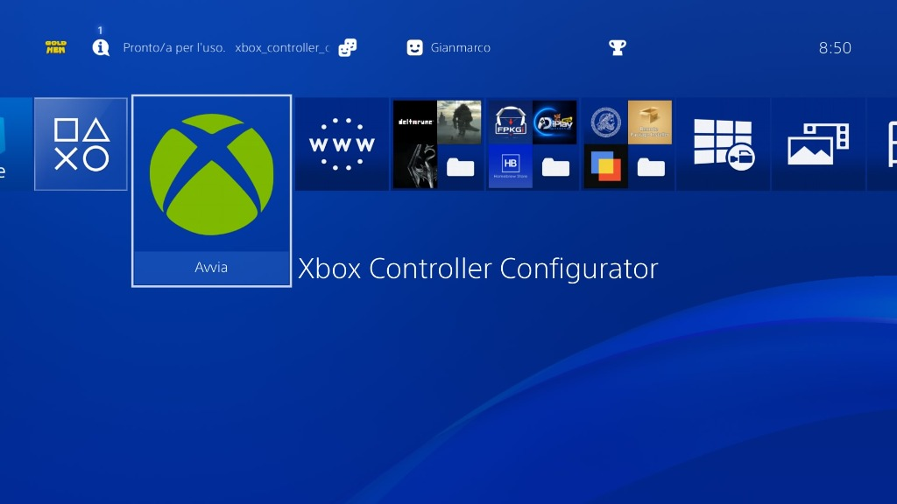
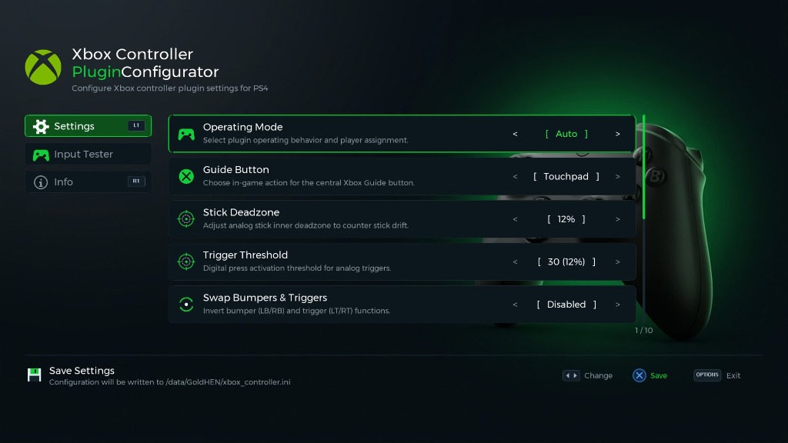
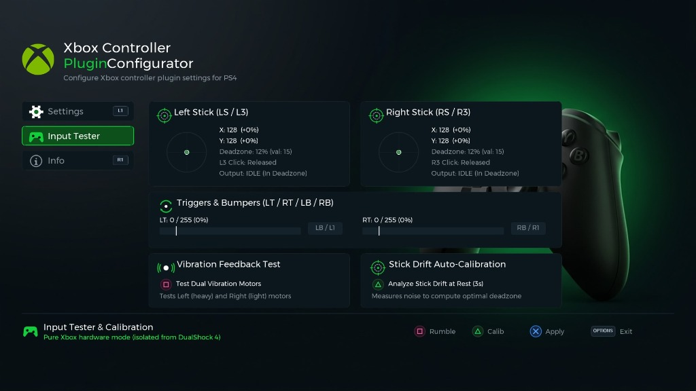
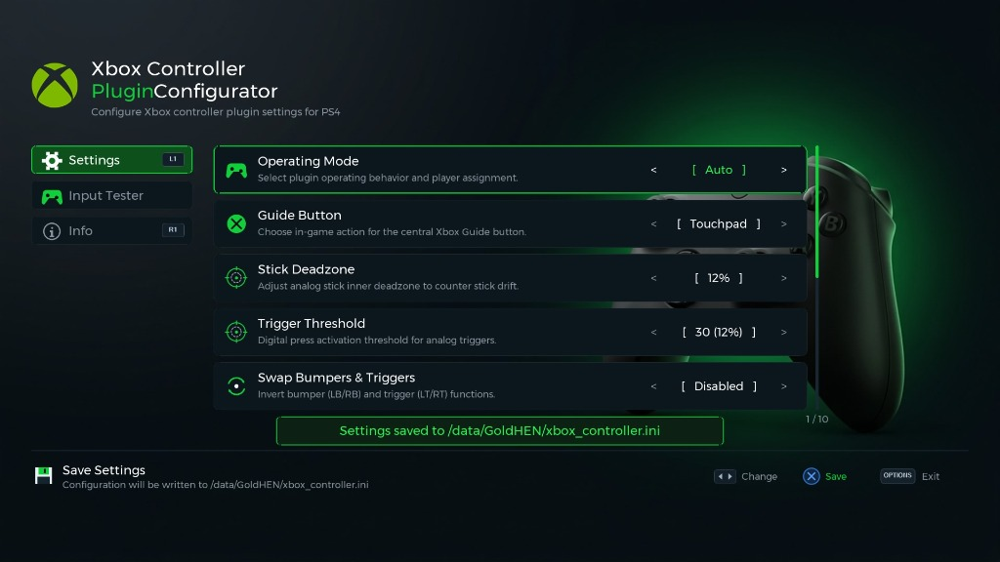

# Xbox Controller Plugin for PS4

A GoldHEN plugin and companion homebrew configurator that enables Xbox, XInput, and Nintendo Switch USB controllers on jailbroken PS4 consoles.

## Status: WORKING (Global Game & Homebrew Support: Single Player Merge + Local Multiplayer Secondary)

Xbox, XInput, and Switch controllers work as:
- **Global `[default]` Support:** works automatically across all PlayStation 4 games and Homebrew applications (Apollo Save Tool, Itemzflow, PS4-Explorer, Homebrew Store, Configurator, etc.) with a single `[default]` entry in `plugins.ini`, while safely excluding background system daemons.
- **Player 1 (Single Player)** in `merge` mode (1 user logged in), usable alongside or in place of the DualShock 4.
- **Player 2 (Local Multiplayer)** in `secondary` mode (2+ users logged in).
- **Hotplug supported:** connect, disconnect, and reconnect controllers freely at any time.
- **GUI Configurator Included:** companion PS4 homebrew application to customize settings on-console without a PC.

---

## Companion App: Xbox Controller Configurator (Optional)

An optional companion homebrew application (`.pkg`) is included for users who prefer to configure and preview plugin settings directly on their PS4:

> **Note:** The configurator application is **completely optional**. The plugin works out of the box on its own without it, and settings can also be edited manually via `/data/GoldHEN/xbox_controller.ini`.

<p align="center">
  
  
</p>
<p align="center">
  
  
</p>

### Configurator Features:
- **3-Tab Navigation (L1 / R1):** Switch effortlessly between **Settings** (Tab 0), **Input Tester & Calibration** (Tab 1), and **Info & Help** (Tab 2).
- **Comprehensive On-Console Configuration:** Adjust all 10 plugin parameters directly on your TV using a smooth 5-card scrollable viewport with real-time scrollbar and position tracking (Operating Mode, Guide Button, Stick Deadzone, Trigger Threshold, Swap Bumpers & Triggers, Vibration, GoldHEN Notifications, Mode Toggle Combo, Homebrew Navigation, and Switch Controller Layout).
- **Live Input Tester & Calibration:**
  - **Stick Reticles & Deadzone Visualizer:** Real-time dual stick crosshairs with live coordinates and dynamic dashed inner deadzone radius circle.
  - **Triggers & Bumpers Telemetry:** Analog progress bars for LT and RT with percentage readouts and digital threshold indicators, plus real-time bumper status pills.
  - **Vibration Feedback Test (Square):** Tests Left heavy motor, Right light motor, and dual-motor pulse with real-time visual phase feedback.
  - **Stick Drift Auto-Calibration (Triangle):** Samples stick resting positions for 3 seconds to measure hardware noise, calculates the optimal recommended deadzone, and applies & saves it instantly on **Cross**.
  - **Pure Hardware Isolation:** Utilizes virtual handle `1001` to test raw Xbox inputs and rumble completely isolated from DualShock 4 data, even in `MERGE (P1)` mode.
- **Automatic Initialization:** Automatically creates `/data/GoldHEN/xbox_controller.ini` on first boot if missing, or reads and updates existing configuration.
- **Instant Save:** Press **Cross (X)** to save settings immediately with a real-time confirmation toast banner.

---

### Supported Controllers

**Xbox Controllers:**
- Xbox 360 wired USB controller (with vibration support)
- Xbox One wired USB controller (with vibration support & Guide button)
- Xbox Series X|S wired USB controller (with vibration support & Guide button)
- Xbox Elite controllers (wired)

**Third-Party Xbox & XInput Controllers (PowerA, Hori, Razer, 8BitDo, Mad Catz, PDP, etc.):**
- Compatible with Xbox One, Series X|S, 360, and **every standard XInput controller**.
- Any wired controller in **XInput / Xbox mode** is detected automatically from its USB interface descriptor:
  - Xbox 360 compatible: class `FF/5D/01`
  - Xbox One compatible: class `FF/47/D0`
- Detection does not rely on a static VID/PID list. A notification will display the detected `VID:PID`.
- Controllers equipped with a physical mode switch (X / D / S) must be set to **X (XInput)** mode. DInput/HID modes are not supported.
- Supported third-party Xbox One pads (including PDP and PowerA models) automatically receive their required vendor initialization packets.

**Nintendo Switch Controllers (PDP):**
- PDP Rock Candy Wired Controller
- PDP Faceoff Wired Pro Controller
- PDP Faceoff Deluxe Wired Pro Controller
- PDP Wired Fight Pad Pro

### Modes & Runtime Switching

The plugin operates in one of three modes (no `.ini` configuration file is needed):

| Mode | Behavior | When to Use |
|------|----------|-------------|
| **`AUTO`** *(Default)* | Automatically selects **`MERGE (P1)`** if **1 user** is logged into the PS4, or **`SECONDARY (P2)`** if **2+ users** are logged in. | Everyday use — works automatically for both single-player and local co-op. |
| **`MERGE (P1)`** | Overlays the Xbox/Switch controller inputs onto Player 1's DualShock 4 handle. Both controllers work simultaneously (and you can even turn off the DS4 once the game is running). | Single-player games, or when 2+ users are logged in on the console but you still want the Xbox pad to control Player 1. |
| **`SECONDARY (P2)`** | Assigns the Xbox/Switch controller to the second logged-in user via a dedicated virtual handle (`1001`), while the DualShock 4 controls Player 1. | Local multiplayer / split-screen / co-op games. |

#### Manual Mode Switch Combo
Hold **`LB + RB + Back + Start`** *(Xbox)* or **`L + R + - + +`** *(Switch)* simultaneously for **~1.5 seconds** at any time in-game to cycle through modes:
`AUTO` → `SECONDARY (P2)` → `MERGE (P1)` → `AUTO`

An on-screen notification will confirm the active mode. (Mode selection is temporary for the current session and resets to `AUTO` when the game closes.)

### Special Controls
- **Central Xbox Guide / Home Button:** Mapped directly to **Touchpad Click (`DS4_BUTTON_TOUCHPAD`)**. Press the central Xbox glowing logo button to instantly open the Map, Inventory, or Journal in any PS4 game.
- **Back / View Button (*Minus* `-` on Switch):** 
  - **Tap (< 2 seconds):** Sends a **Share Button (`DS4_BUTTON_SHARE`)** pulse.
  - **Hold (>= 2 seconds):** Also acts as Touchpad Click.
- **Mode Switch Combo:** Hold **LB + RB + Back + Start** for **1.5 seconds** to cycle modes (`AUTO` -> `SECONDARY (P2)` -> `MERGE (P1)`).

### What Works
- Global `[default]` mode in `plugins.ini` (automatically active across all retail PS4 games and homebrew apps; safely excludes system daemons)
- Full button mapping (A/B/X/Y, bumpers, triggers, sticks, D-pad, Touchpad Click via Guide button, Share)
- Dedicated 250 Hz background USB polling thread (non-blocking, low latency)
- Dynamic descriptor-based detection for official and third-party controllers
- Hotplugging: automatic detection on disconnect and reconnect at any time
- Automatic `merge` (1 user) and `secondary` (2+ users) modes with runtime combo override
- Rumble/vibration feedback on Xbox 360 and Xbox One/Series
- Diagnostics logging to notifications and `/data/GoldHEN/xbox_controller.log` (with 64 KB rotation)

### Not Supported
- Navigating the native PS4 System Dashboard / XMB (the PS4 Dashboard receives input strictly via kernel drivers `/dev/btpad` and cannot be controlled by userland `scePadRead` plugins like `remotePad` or `gamepad_helper`)
- Wireless/Bluetooth Xbox controllers without USB cable
- Controller headphone audio passthrough
- Console power-on and initial GoldHEN activation before the plugin is loaded

---

## Requirements

- Jailbroken PS4 (tested on firmware 9.00 up to 13.52)
- GoldHEN (latest version, or 2.3+)
- Supported **wired** USB controller (Xbox 360/One/Series or PDP Switch controller)
- DualShock 4 controller (required to turn on the console and activate GoldHEN)

---

## Installation

### 1. Plugin Installation (`xbox_controller.prx`)
1. Connect to your PS4 via FTP (port 2121).
2. Upload `xbox_controller.prx` to `/data/GoldHEN/plugins/`.
3. Create or edit `/data/GoldHEN/plugins.ini`. Enable the plugin under `[default]` so it automatically works across all your games:
   ```ini
   [default]
   /data/GoldHEN/plugins/xbox_controller.prx
   ```
   *(Alternatively, if you only want it on specific games, you can place it under a Title ID section such as `[CUSAXXXXX]`.)*

4. Launch any game or homebrew application — the Xbox controller is automatically detected and ready. Both retail games and homebrew tools (Apollo Save Tool, Itemzflow, PS4-Explorer, Homebrew Store, Configurator, etc.) are fully navigable with the controller, while background system daemons are safely excluded.

To disable: remove or comment out the plugin line in `plugins.ini`.

### 2. Configurator App Installation (`.pkg`, Optional)
*(Optional: only needed if you wish to configure parameters directly on your TV via GUI. Without the app, the plugin continues to function normally.)*
1. Copy `xbox_controller_configurator.pkg` to a USB drive (FAT32/exFAT) or transfer it via FTP.
2. On your PS4, go to **GoldHEN** > **Package Installer**.
3. Install `xbox_controller_configurator.pkg`.
4. The **Xbox Controller Configurator** will appear directly on your PS4 dashboard (XMB). Launch it at any time to customize and save your settings!

---

## Configuration File (`xbox_controller.ini`)

The plugin can optionally read persistent settings from `/data/GoldHEN/xbox_controller.ini`. 
> **Note:** The configuration file is **completely optional**. If it does not exist, the plugin preserves default v1.4.0 behavior with zero setup required. You can edit this file manually via FTP or using the **Xbox Controller Configurator** companion app on your PS4.

### Example Configuration:
```ini
[General]
; Operating mode: auto (default), merge, secondary
mode = auto

; Central Xbox Guide button in-game action: touchpad (default), share, none
guide_action = touchpad

; Show on-screen connection and mode notifications: 1 (default), 0
enable_notifications = 1

; Allow in-game mode cycling combo (LB+RB+Back+Start): 1 (default), 0
enable_mode_combo = 1

; Enable controller vibration/rumble feedback: 1 (default), 0
enable_rumble = 1

; Support controller navigation inside homebrew apps: 1 (default), 0
enable_homebrew = 1

[Deadzone]
; Stick inner deadzone (0-127, default 15 = ~12%)
stick_deadzone = 15

; Digital trigger activation threshold (0-255, default 30 = ~12%)
trigger_threshold = 30

[Remap]
; Invert bumpers and triggers (LB/RB <-> LT/RT): 0 (default), 1
swap_triggers_bumpers = 0

; Nintendo Switch layout: 1 = positional (bottom=X, default), 0 = by letter (A=Circle)
switch_positional_layout = 1
```

---

## How to Use

### Single Player Setup (`MERGE` Mode)

1. Log in with **1 user profile** on your PS4 using your DualShock 4.
2. Plug in your wired Xbox or Switch controller (before or after launching the game — hotplug is supported).
3. Launch the game. Because only 1 user is logged in, `AUTO` mode automatically selects **`MERGE (P1)`**.
4. Play using the Xbox/Switch controller as Player 1:
   - You can leave the DualShock 4 on alongside the Xbox controller (useful if a game requires touchpad swipes or gyro aiming), **or** turn off the DualShock 4 after the game has started.
   - *Tip:* If you have 2 user profiles logged in on your PS4 (which causes `AUTO` to default to `SECONDARY`), simply hold **`LB + RB + Back + Start`** for 1.5 seconds to switch to **`MERGE (P1)`**.

### Local Multiplayer Setup (`SECONDARY` Mode)

For 2-player local multiplayer / co-op:

1. **Create a second PS4 user profile** (`Settings` > `Users` > `Create User`).
2. **Log in both users** before launching the game:
   - Profile 1 (Player 1 — DualShock 4)
   - Profile 2 (Player 2 — Xbox/Switch controller)
3. Launch the game. Because 2+ users are logged in, `AUTO` mode automatically selects **`SECONDARY (P2)`**.
4. On-screen notifications will confirm controller detection and Player 2 assignment.
5. Both controllers now operate independently.

> **Note:** Both users must be signed in at the PS4 system level before starting the game.

#### Drop-in Games (Diablo III, etc.)

For games where Player 2 joins mid-game by pressing Start/Options:
1. **Create your Player 2 character on the second profile first** (launch the game once as Player 2 to create save data before attempting co-op).
2. Once the character exists, press **Start** on the Xbox controller to drop into the session.

---

## Button Mapping

### Xbox Controllers

| Xbox | DualShock 4 |
|------|-------------|
| A | Cross (X) |
| B | Circle |
| X | Square |
| Y | Triangle |
| LB | L1 |
| RB | R1 |
| LT | L2 |
| RT | R2 |
| Back / View | Share *(short press < 2 s)* / Touchpad Click *(hold ≥ 2 s)* |
| Start / Menu | Options |
| Guide | PS Button *(in-game bit)* |
| L3 | L3 |
| R3 | R3 |
| LB + RB + Back + Start *(hold 1.5 s)* | Cycle Plugin Mode (`AUTO` → `SECONDARY` → `MERGE`) |

### Switch Controllers (PDP)

| Switch | DualShock 4 |
|--------|-------------|
| A | Circle |
| B | Cross (X) |
| X | Triangle |
| Y | Square |
| L | L1 |
| R | R1 |
| ZL | L2 |
| ZR | R2 |
| - (Minus) | Share *(short press < 2 s)* / Touchpad Click *(hold ≥ 2 s)* |
| + (Plus) | Options |
| Home | PS Button *(in-game bit)* |
| L3 | L3 |
| R3 | R3 |
| L + R + - + + *(hold 1.5 s)* | Cycle Plugin Mode (`AUTO` → `SECONDARY` → `MERGE`) |

*Note: Switch controllers follow positional mapping (A corresponds to Circle, B to Cross).*

---

## Limitations

- **Touchpad gestures/swipes** are not available on Xbox/Switch controllers (however, **Touchpad Click** is supported by holding `Back`/`View`/`-` for 2 seconds, and in `MERGE` mode you can still swipe on the physical DS4 touchpad).
- **Motion controls** (gyroscope/accelerometer) are unavailable on Xbox/Switch controllers (in `MERGE` mode, the physical DS4's motion sensors remain active).
- **Console power-on and initial GoldHEN activation** require a DualShock 4 before the plugin is loaded.
- Lightbar color feedback is not supported.
- Controller headphone audio passthrough is not supported.
- Switch PDP controller triggers operate digitally (full press only) and do not support vibration.

---

## Building

### Prerequisites

- [OpenOrbis PS4 Toolchain](https://github.com/OpenOrbis/OpenOrbis-PS4-Toolchain)
- [GoldHEN Plugins SDK](https://github.com/GoldHEN/GoldHEN_Plugins_SDK) (included as submodule)

Clone the repository recursively:
```bash
git clone --recursive https://github.com/ChiricoG/xbox_controller_plugin.git
cd xbox_controller_plugin
```
If already cloned without `--recursive`, initialize submodules:
```bash
git submodule update --init --recursive
```

### Linux / macOS

Set the `OO_PS4_TOOLCHAIN` environment variable and run `make`:
```bash
export OO_PS4_TOOLCHAIN=/path/to/openorbis-toolchain
make
```

Output: `bin/xbox_controller.prx`

### Windows (MSYS2)

1. Install MSYS2 with Clang and LLD:
   ```bash
   pacman -S msys/clang msys/lld msys/llvm
   ```
2. Build or obtain `create-fself.exe` from [OpenOrbis create-fself](https://github.com/OpenOrbis/create-fself).
3. Set your environment variables and execute the build script from an MSYS2 shell:
   ```bash
   export OO_PS4_TOOLCHAIN=/c/path/to/OpenOrbis/PS4Toolchain
   export CREATE_FSELF=/c/path/to/create-fself.exe
   bash build_windows.sh
   ```

Output: `bin/xbox_controller.prx`

---

## Technical Details

This plugin hooks and coordinates several PS4 system APIs:
- **Dynamic Runtime Symbol Resolution (`sys_dynlib_load_prx` + `sys_dynlib_dlsym`)** — The PRX links only against `libkernel` and `libSceLibcInternal` (`0` static `R_X86_64_GLOB_DAT` relocations), resolving `libScePad`, `libSceUsbd`, and `libSceUserService` dynamically at runtime so it can load safely under `[default]` into Retail Games, Homebrew Apps, and `SceShellUI`.
- **Process Filtering & `SceShellUI` Auto-Injection (`sys_sdk_proc_info` / `sys_sdk_proc_prx_load`)** — Automatically skips non-UI system daemons (`NPXS*` except `NPXS20001`) and helper subprocesses (`WebProcess`, `compiler`, `Daemon`, `Dialog`), while injecting once per boot session into `SceShellUI` (`NPXS20001`) for Dashboard control.
- **Cross-Process Shared State (`/data/GoldHEN/xbox_ipc.bin`)** — Coordinates the active USB Master and IPC Clients via `sceKernelPread` / `sceKernelPwrite` so `SceShellUI` and the running Game share translated pad inputs, mode changes, and rumble requests without `sceUsbdClaimInterface` conflicts, while respecting `ORBIS_PAD_BUTTON_INTERCEPTED` (`0x80000000`) input focus.
- `scePadOpen` / `scePadClose` / `scePadGetHandle` — Real handle tracking (`MERGE`) and virtual controller registration (`SECONDARY`, handle `1001`)
- `scePadRead` / `scePadReadState` — Controller input overlay (`MERGE`) and virtual/fallback pad injection (`SECONDARY`)
- `scePadGetControllerInformation` — Pad status and capability reporting
- `scePadSetVibration` — Rumble forwarding to Xbox 360 and Xbox One/Series controllers
- `scePadSetLightBar` / `scePadResetLightBar` / `scePadSetMotionSensorState` — Safe virtual handle stubs (verified via HDE64 prologue disassembly)
- `sceUserServiceGetLoginUserIdList` / `sceUserServiceGetForegroundUser` — User counting for `AUTO` mode and Player 2 assignment
- `sceUsbd` — Dedicated 250 Hz background polling thread (`scePthreadCreate`), USB hotplug scanner, descriptor parsing, and interrupt transfers
- Diagnostics logger (`src/log.c`) writing to `/data/GoldHEN/xbox_controller.log` via direct `libkernel` file I/O

---

## License

This project is licensed under the MIT License. See [LICENSE](LICENSE) for details.

---

## Credits

- GoldHEN team for the plugin SDK and `gamepad_helper` reference
- OpenOrbis team for the PS4 toolchain and reverse engineering tooling
- `remotePad` plugin for virtual controller architecture inspiration
